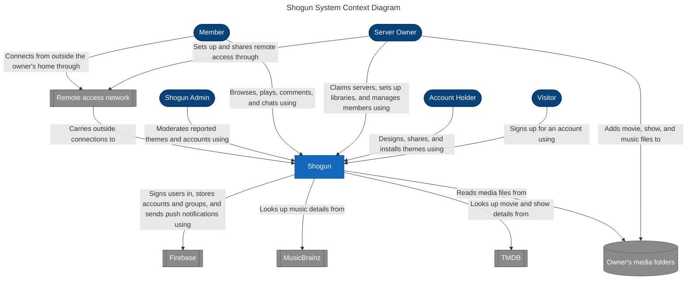

## Decisions and Explanations

### How Roles Change
A Visitor becomes an Account Holder by signing up. An Account Holder becomes a Server Owner by claiming a server, and becomes a Member by accepting an invite. Every Owner and Member is still an Account Holder, so each box's arrow lists only what that role adds.

### Why Remote Access is a Generic Box
The owner chooses how their Server is reached from outside the home (Tailscale, their own domain with port forwarding, or a tunnel), so the diagram names the role, not a vendor. US-04 (Reach my server from anywhere) breaks without some remote access path, so it belongs on the diagram even though Shogun doesn't run it.

## Legend

| Shape | Color | Meaning |
|-------|-------|---------|
| Rounded (stadium) box | Dark blue | A **person** who uses Shogun |
| Plain rectangle | Blue | **Shogun**, the system being built. Everything inside it is drawn in the container diagram (Step 3). |
| Double-sided box | Grey | An **external system** that Shogun depends on but doesn't build or run |
| Cylinder | Grey | **External storage**: files Shogun reads but doesn't own |
