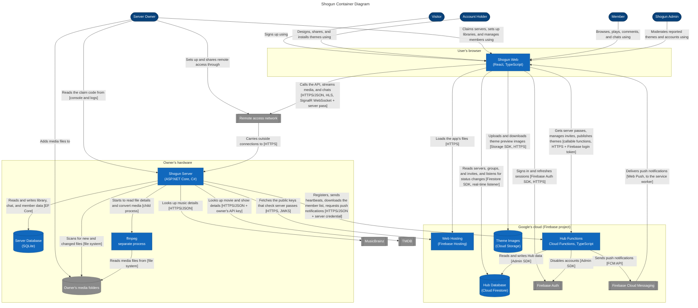

## Containers

| Name | Technology | Responsibility | Runs where | Run by whom |
|------|------------|----------------|------------|-------------|
| Shogun Web | React, TypeScript, Vite | The app every person uses: sign-in, server list, browsing, the player, chat, themes, and the admin page | The user's browser | Each user |
| Web Hosting | Firebase Hosting | Serves the web app's files and the public keys (JWKS) that Servers use to check server passes | Google's cloud | You |
| Hub Functions | Cloud Functions, TypeScript | All Hub logic that needs trust: claiming, heartbeats, server passes, invites, member lists, push requests, moderation | Google's cloud | You |
| Hub Database | Cloud Firestore | Profiles, servers and their addresses and status, group memberships, invites, push tokens, Workshop theme data | Google's cloud | You (Google runs the database) |
| Theme Images | Cloud Storage | Workshop theme preview images | Google's cloud | You (Google runs the storage) |
| Shogun Server | ASP.NET Core, C# | The REST API, streaming, chat, library scanning, metadata matching, and checking server passes | The owner's hardware | Each server owner |
| Server Database | SQLite (EF Core) | Libraries, files, metadata, a copy of the member list, permissions, watch progress, chat, and comments | The owner's hardware | Each server owner |
| ffmpeg | ffmpeg | Reads file details and converts media the browser can't play | The owner's hardware, started by the Server | Each server owner |

## Decisions and Explanations

## Legend

| Shape | Color | Meaning |
|-------|-------|---------|
| Rounded (stadium) box | Dark blue | A **person** (same as the context diagram) |
| Rectangle | Blue | A **container** you build or configure: an app or a set of functions |
| Cylinder | Blue | A **data store** you design (Google or the owner runs the hardware) |
| Double-sided box or grey cylinder | Grey | An **external system** or storage that Shogun doesn't build |
| Outlined group | | **Where it runs.** Arrows that cross a group's edge cross a trust boundary (Step 4). |
