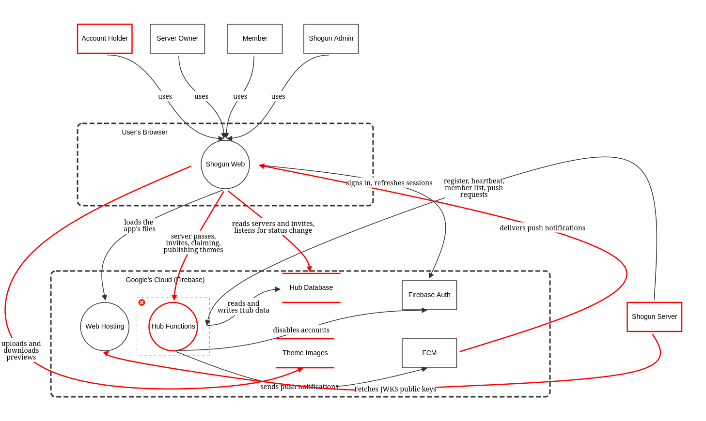
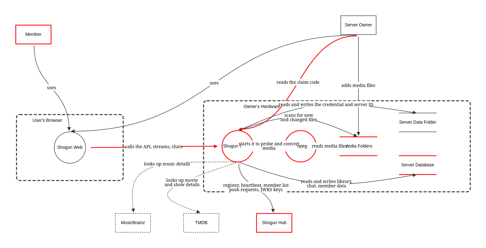

# Shogun Threat Model

A STRIDE walk of the [container diagram](03-containers.md), split into two diagrams: the **Hub** (browser and Google's cloud) and the **Home** server (browser and the owner's hardware). This page summarizes the models and records what changed because of them. The full list of threats lives in the Threat Dragon models.

| Model                                                                                                       | Diagram                       | Threats | Open | Mitigated | N/A |
| ----------------------------------------------------------------------------------------------------------- | ----------------------------- | ------- | ---- | --------- | --- |
| [Hub](../../ThreatDragonModels/Shogun%20-%20Hub%20Threat%20Model/Shogun%20-%20Hub%20Threat%20Model.json)    | Browser <--> Google's cloud   | 26      | 18   | 1         | 7   |
| [Home](../../ThreatDragonModels/Shogun%20-%20Home%20Threat%20Model/Shogun%20-%20Home%20Threat%20Model.json) | Browser <--> owner's hardware | 31      | 21   | 2         | 8   |

To view or edit the models, open them in [OWASP Threat Dragon](https://www.threatdragon.com/) from the `design` branch. Close a model in Threat Dragon before changing its JSON file by hand, so an open tab can't save over the change.

---

## 1. What are we working on?

### Hub

### Home

### Trust boundaries

| Boundary                      | Controlled by     | Contains                                                                   | Why the others can't trust it                                                                                                              |
| ----------------------------- | ----------------- | -------------------------------------------------------------------------- | ------------------------------------------------------------------------------------------------------------------------------------------ |
| **User's browser**            | Each user         | Shogun Web                                                                 | A user can change the app's code in their browser or send hand-made requests, so the Hub and the Server check everything the browser sends |
| **Google's cloud (Firebase)** | Shogun Owner (Me) | Web Hosting, Hub Functions, Hub Database, Theme Images, Firebase Auth, FCM | The one place I fully control, so trust decisions are made here                                                                            |
| **Owner's hardware**          | Each server owner | Shogun Server, ffmpeg, Server Database, Server Data Folder, Media Folders  | The owner is a stranger to their members and to me, and can read or change anything on their machine                                       |

People, MusicBrainz, and TMDB sit outside every boundary. On each diagram, the other side appears as one actor: Shogun Server on the Hub diagram, Shogun Hub on the Home diagram.

### Why two diagrams

The container diagram has about 25 flows, which is too many for one readable canvas. The two halves meet at only two points (the browser, and the Server ↔ Hub connection), so each can be walked on its own. Threats on the Server <--> Hub connection are listed once, on the Hub model, and the Home model points to them.

### Out of scope

| Element                                  | Reason                                                                                              |
| ---------------------------------------- | --------------------------------------------------------------------------------------------------- |
| MusicBrainz, TMDB, and the flows to them | Shogun only reads public data from them. The owner's TMDB key is sent only to TMDB, which issued it |

---

## 2. What can go wrong?

### Attackers

| Attacker                                       | What they want                                                                                            |
| ---------------------------------------------- | --------------------------------------------------------------------------------------------------------- |
| **Stranger on the internet**                   | Take over servers or accounts, read Hub data, run up the Firebase bill                                    |
| **Curious or malicious member**                | See libraries they weren't given, act as the owner, change other members' data, flood chat or transcoding |
| **Removed member**                             | Keep watching after being removed                                                                         |
| **Dishonest server owner**                     | Collect members' data, or reuse anything members send to their Server on the Hub                          |
| **Malicious theme author**                     | Run code in other users' browsers through a workshop theme                                                |
| **Someone with access to the owner's machine** | Read the server credential, the claim code, or the database                                               |

### Highest-priority threats

The High-priority threats from both models, plus anything still missing from the roadmap. The status notes come from each threat's mitigation field (see [Status convention](#status-convention)).

| Threat                    | Model | Where                                     | STRIDE                 | Status                                            |
| ------------------------- | ----- | ----------------------------------------- | ---------------------- | ------------------------------------------------- |
| Tampering Servers         | Hub   | Shogun Web -> Hub Database                | Tampering              | Planned: Phase 2A Steps 3–4                       |
| Reading Server Info       | Hub   | Shogun Web -> Hub Database                | Information disclosure | Planned: Phase 2A Steps 3–4                       |
| Exposed Credential Hashes | Hub   | Hub Database                              | Information disclosure | Planned: Phase 2A Steps 3–4                       |
| Claim Codes               | Hub   | Hub Functions                             | Spoofing               | Planned: Phase 2A Steps 5–6                       |
| Server Credentials        | Hub   | Shogun Server (actor)                     | Spoofing               | Planned: Phase 2A Steps 5–6 and 7B                |
| Calling Admin Functions   | Hub   | Hub Functions                             | Elevation of privilege | Planned: Phase 6 Step 7                           |
| Malicious Themes          | Hub   | Shogun Web -> Hub Functions, Theme Images | Tampering              | Planned: Phase 6 Steps 9 and 11                   |
| Replayed Pass             | Home  | Shogun Server                             | Spoofing               | Planned: Phase 2A Step 10                         |
| Edited Role               | Home  | Shogun Server                             | Tampering              | Planned: Phase 2A Step 10                         |
| Owner-Only Endpoints      | Home  | Shogun Server                             | Elevation of privilege | Done: Phase 1B Step 5 · Planned: Phase 2A Step 10 |
| Library Permissions       | Home  | Shogun Server                             | Information disclosure | Planned: Phase 3 Step 2, Phase 6 Step 2           |
| Path Traversal            | Home  | Shogun Web -> Shogun Server               | Information disclosure | Planned: Phase 3 Step 2                           |
| Traffic in Transit        | Home  | Shogun Web -> Shogun Server               | Tampering              | Planned: Phase 5 Step 6                           |
| Credential File           | Home  | Server Data Folder                        | Information disclosure | **Mitigated:** Phase 1B Step 6                    |
| Argument Injection        | Home  | Shogun Server -> ffmpeg                   | Tampering              | **Missing:** suggested for Phase 3 Step 6         |

---

## 3. What are we going to do about it?

### Status convention

Nothing on the Hub is built yet, and Threat Dragon 2.6.2 only offers _Open_, _Mitigated_, and _N/A_. So:

| Status in Threat Dragon | Means                                                 | Note in the mitigation field |
| ----------------------- | ----------------------------------------------------- | ---------------------------- |
| **Mitigated**           | The protection exists today, in Shogun or in Firebase | `DONE: Phase X Step N`       |
| **Open**                | Covered by a roadmap step that hasn't been built yet  | `PLANNED: Phase X Step N`    |
| **Open**                | Not covered by any step                               | `MISSING: ...`               |
| **Open**                | Can't be prevented and is knowingly accepted          | `ACCEPTED RISK: ...`         |
| **N/A**                 | Doesn't apply, with the reason written down           | `N/A: ...`                   |

### Roadmap changes made because of this model

| Gap                                                                      | Threat                   | Change                                                                                                                                                                               |
| ------------------------------------------------------------------------ | ------------------------ | ------------------------------------------------------------------------------------------------------------------------------------------------------------------------------------ |
| A leaked server credential couldn't be replaced without losing the group | Server Credentials (Hub) | Phase 2A Step 7B: 30-day rotation with a grace period; the owner can revoke and re-claim |
| Admin actions were only in function logs, which expire after 30 days     | Denying Actions (Hub)    | Phase 6 Step 7, item 5: an append-only `moderationLog` collection                             |

### Still missing

| Threat                    | What's needed                                                                                                 | Suggested home                                                                                   |
| ------------------------- | ------------------------------------------------------------------------------------------------------------- | ------------------------------------------------------------------------------------------------ |
| Argument Injection (Home) | Pass ffmpeg its arguments as a list (`ProcessStartInfo.ArgumentList`), never as one string or through a shell | Phase 3 Step 6 |

### Accepted risks

| Threat                 | Why it's accepted                                                                                             | What we do instead                                                                                                                                                                                                                                                              |
| ---------------------- | ------------------------------------------------------------------------------------------------------------- | ------------------------------------------------------------------------------------------------------------------------------------------------------------------------------------------------------------------------------------------------------------------------------- |
| Dishonest Owner (Home) | Members' IP addresses, watch history, and chat live on the owner's machine, so the owner can always read them | Say so plainly in the app (Phase 6 Step 7), and never send Firebase login tokens to Servers (architecture.md §3) |

### Decisions made while modeling

| Question | Decision | Threat |
|----------|----------|--------|
| Can the owner read a deleted message? | **Yes.** Deleting hides a message from members, but the owner can still read it until the retention period ends, so a member can't erase abuse by deleting it. The chat notice tells members this (Phase 6 Steps 4 and 7) | Deleted Abuse (Home) |
